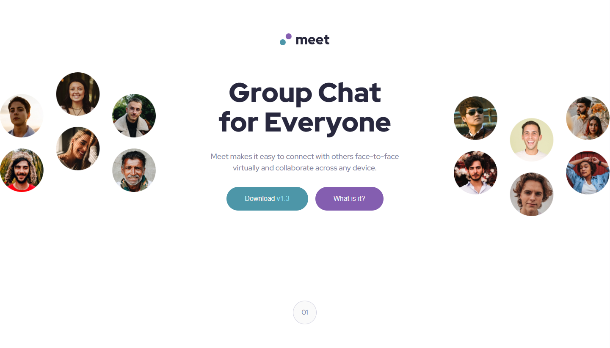

# Frontend Mentor - Meet landing page

## Overview

For this challenge, I built and deployed Frontend Mentor's "Meet landing page". They provided all the necessary assets, including the images, a Figma file, and a comprehensive style guide.

[Frontend Mentor Meet landing page challenge](https://www.frontendmentor.io/challenges/meet-landing-page-rbTDS6OUR)

This challenge required knowledge of CSS, Flexbox, CSS Grid, semantic HTML, and responsive web design.

### Screenshot

### Links

- Solution URL: [github repository](https://github.com/ClassPython/fem-meet-landing-page)
- Live Site URL: [github-pages](https://classpython.github.io/fem-meet-landing-page/)

### Built with

- Semantic HTML5 markup
- CSS Flexbox
- CSS Grid
- Mobile first design

### What I learned

• The biggest challenges were:
	• Creating a non-sticky footer.
	• Preventing image overflow in responsive containers.
	• Maintaining aspect ratios for each image.
• Building a non-sticky footer: I achieved this by setting up a Flexbox container on the body, applying flex: 1 0 auto to the main element, and adding flex-shrink: 0 to both the header and footer.
• Preventing image overflow: I resolved this by applying overflow: hidden to the image container and assigning object-fit: cover and flex-shrink: 0 to each image.
• Maintaining aspect ratios: I accomplished this by adding aspect-ratio: width/height to the img tags and updating the property at the appropriate media queries.
 

 ### Next Steps

- Complete the six projects in Frontend Mentor's "JavaScript Fundamentals" learning path.

